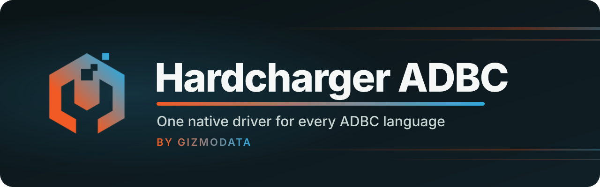

<p align="center">
  <a href="https://github.com/gizmodata/hardcharger">
    
  </a>
</p>

<p align="center">
  <a href="https://pypi.org/project/adbc-driver-hardcharger/"></a>
  <a href="https://arrow.apache.org/adbc/"></a>
  <a href="https://github.com/gizmodata/warp-sql"></a>
  
  
  <a href="https://github.com/gizmodata/hardcharger"></a>
  <a href="LICENSE"></a>
  <a href="https://gizmodata.com"></a>
</p>

<h3 align="center">Query Hardcharger from Python, C/C++, Go, R, Rust or any ADBC language.</h3>

---

## 🔌 What is it?

The [ADBC](https://arrow.apache.org/adbc/) driver for
[Hardcharger](https://github.com/gizmodata/hardcharger), GizmoData's DuckDB 2.0 server. It is
a native Go driver built on the generic [Warp SQL ADBC driver](https://github.com/gizmodata/warp-sql-adbc),
which does the work (Arrow IPC streaming, bind parameters, bulk ingest, partitioned results,
cancel, retries, TLS), compiled to one C shared library, `libadbc_driver_hardcharger`, that
every ADBC language loads. On top of Warp SQL it adds what is particular to Hardcharger, for
every language at once:

- 🏎️ **`hardcharger://` URIs**, with Hardcharger's port 31337 as the default;
- 🏷️ **query and session tags**, recorded with every statement in Hardcharger's instrumentation;
- ⚙️ **`hardcharger.*` settings**: set them for every session, or read, set and reset them on one;
- 🌐 **browser sign-in** through the server's identity provider (SSO);
- 🧾 **"ADBC Hardcharger Driver - Go"** as the driver name in GetInfo (the vendor name,
  "Hardcharger", comes from the server);
- 🧩 **a driver manifest**, so `driver = "hardcharger"` finds it in any ADBC driver manager.

> **Status: in development, unreleased (0.1.0).** Tested against `hardcharger-server` built
> from Hardcharger's main branch.

| Package | What it is |
|---|---|
| `pip install adbc-driver-hardcharger` | this driver: Python bindings, with the library in the wheel |
| `pip install hardcharger` | the Hardcharger **server**, started from Python |
| `pip install "hardcharger[adbc]"` | both |
| `go get github.com/gizmodata/hardcharger-adbc/go` | the Go package |
| [Releases](https://github.com/gizmodata/hardcharger-adbc/releases) | the library and the manifest template, for C/C++, R, Rust, ... |

## 🚀 Quick start

### Python

```python
from adbc_driver_hardcharger import dbapi as hardcharger

with hardcharger.connect(uri="hardcharger://localhost?tls=false", username="hardcharger", password="change-me") as conn:
    with conn.cursor() as cur:
        cur.execute(operation="SELECT 42 AS answer, ? AS greeting", parameters=["hello"])
        print(cur.fetch_arrow_table())
```

The connection and cursor are DB-API 2.0 objects with ADBC's extensions:
`fetch_arrow_table()`, `fetchall()`, `adbc_ingest()` for bulk loads, `adbc_get_objects()` and
the rest.

### C/C++ (through the ADBC driver manager)

With the manifest installed (see [Driver manifest](#-driver-manifest)), the driver manager
finds the driver by name:

```c
#include <arrow-adbc/adbc.h>
#include <arrow-adbc/adbc_driver_manager.h>

// (error handling elided; see examples/c/hello.c)
AdbcDatabaseNew(&database, &error);
// Search ADBC_DRIVER_PATH and the user and system directories for hardcharger.toml.
AdbcDriverManagerDatabaseSetLoadFlags(&database, ADBC_LOAD_FLAG_DEFAULT, &error);
AdbcDatabaseSetOption(&database, "driver", "hardcharger", &error);
AdbcDatabaseSetOption(&database, "uri", "hardcharger://localhost?tls=false", &error);
AdbcDatabaseSetOption(&database, "username", "hardcharger", &error);
AdbcDatabaseSetOption(&database, "password", "change-me", &error);
AdbcDatabaseSetOption(&database, "adbc.hardcharger.query_tag", "{\"app\": \"hello.c\"}", &error);
AdbcDatabaseInit(&database, &error);
```

[examples/c/hello.c](examples/c/hello.c) is the whole program (it prints `answer = 42`):

```bash
cc examples/c/hello.c -I"$ADBC/include" -L"$ADBC/lib" -ladbc_driver_manager -o hello && ./hello
```

R (`adbcdrivermanager`), Rust (`adbc_driver_manager`) and the other driver managers load it
the same way, by the name `hardcharger`, with the same URIs and options.

### Go

```go
db, err := hardcharger.NewDriver(memory.DefaultAllocator).NewDatabaseWithContext(ctx, map[string]string{
	"uri":                      "hardcharger://localhost?tls=false",
	"username":                 "hardcharger",
	"password":                 "change-me",
	hardcharger.OptionQueryTag: `{"app": "hello.go"}`,
})
cnxn, err := db.Open(ctx)
```

[go/examples/hello](go/examples/hello/main.go) is the whole program (`go run ./examples/hello`
in `go/`). The package is `github.com/gizmodata/hardcharger-adbc/go/hardcharger`.

## 🔗 URIs

| URI | Meaning |
|---|---|
| `hardcharger://host` | HTTPS to `host:31337` |
| `hardcharger://host:port` | HTTPS to another port |
| `hardcharger://host?tls=false` | Plain HTTP (development, loopback) |
| `hardcharger://host:port/custom/prefix` | The server mounts Warp SQL under `/custom/prefix` |
| `warp://…`, `https://…`, `http://…` | The Warp SQL driver's own spellings, as they are |

`hardcharger://` means exactly what Warp SQL's `warp://` means, so TLS is on unless the URI
says `?tls=false`. There is deliberately no `hardcharger+http://`: one spelling for plain HTTP
keeps URIs the same in every driver (JDBC, the `hardcharger` command-line client), and the
driver refuses `hardcharger+http://` with a message naming `?tls=false`.

## ⚙️ Options

Every option of the [Warp SQL driver](https://github.com/gizmodata/warp-sql-adbc#%EF%B8%8F-options)
(`adbc.warp.*`: TLS, tokens, retries, compression, partitioned results, ...) applies, with its
defaults. Hardcharger's:

| Option | Where | Meaning |
|---|---|---|
| `adbc.hardcharger.query_tag` | database, connection | A JSON object recorded with every following statement (`hardcharger.query_tag`); `""` removes it |
| `adbc.hardcharger.session_tag` | database, connection | A JSON object tagging the session (`hardcharger.session_tag`) |
| `adbc.hardcharger.setting.NAME` | database, connection | `SET SESSION hardcharger.NAME`: on every new session (database) or now (connection; `""` resets, and GetOption reads the value that applies) |
| `adbc.hardcharger.global_setting.NAME` | connection | `SET GLOBAL hardcharger.NAME` (admins); `""` resets |
| `adbc.hardcharger.auth_type` | database | `password` (default) or `external`: browser sign-in |
| `adbc.hardcharger.oauth.url` | database | The sign-in server's base URL (`--oauth-base-url`); default `https://HOST:31339` (`http://` with `?tls=false`) |
| `adbc.hardcharger.oauth.port` | database | The sign-in server's port (default 31339) |
| `adbc.hardcharger.oauth.timeout_seconds` | database | How long to wait for the sign-in (default 300) |
| `adbc.hardcharger.oauth.browser` | database | Command that opens the sign-in page (the URL is appended); default `$HARDCHARGER_BROWSER`, else the system's; `none` prints the URL |

Tags are stored in `_hardcharger_instr.sql_statements.query_tag` and
`_hardcharger_instr.sessions.session_tag` when the server runs with `--enable-instrumentation`;
a tag that isn't a JSON object is refused with `Invalid JSON for query_tag`.

## 🐍 Python helpers

```python
with hardcharger.connect(uri="hardcharger://localhost?tls=false", username="hardcharger", password="change-me",
                         session_tag={"app": "nightly-etl"}, query_tag={"job": "load-orders"},
                         settings={"query_timeout": 60}) as conn:
    conn.set_query_tag(tag={"job": "refresh-rollups"})          # every later statement
    conn.set_setting(name="query_timeout", value=120)           # SET SESSION hardcharger.query_timeout
    print(conn.get_setting(name="query_timeout"))                # '120'
    conn.reset_setting(name="query_timeout")
    conn.set_setting(name="max_concurrent_statements", value=8, scope="global")  # admins only
    conn.reset_setting(name="max_concurrent_statements", scope="global")
    print(conn.current_user(), conn.server_version())
    print(conn.settings())                                       # hardcharger_settings(), as Arrow
```

They map to the options above, so they behave exactly as in C or Go.

## 🌐 Browser sign-in (SSO)

When the server runs its browser sign-in (`--oauth-client-id`, `--oauth-client-secret`,
`--oauth-port`, with the identity provider in `--token-allowed-issuer`), sign in as yourself:

```python
with hardcharger.connect(uri="hardcharger://db.example.com", auth_type="external") as conn:
    print(conn.current_user())  # the e-mail address you signed in with
```

When the first connection opens, the driver asks the server's sign-in server for a sign-in,
opens it in your browser, waits, and signs in to Warp SQL with the identity provider's ID token
(token exchange). `open_browser=False` (option `oauth.browser=none`) prints the URL instead,
for a remote shell; a string is the command to open it with. The sign-in server is reached
over HTTPS when the connection is (no fallback to plain HTTP).

## 🧩 Driver manifest

`driver = "hardcharger"` works in any ADBC driver manager once `hardcharger.toml` is in one of
its search directories:

```bash
python -m adbc_driver_hardcharger.manifest          # for this user, pointing at the wheel's library
python -m adbc_driver_hardcharger.manifest --print  # or print it
```

Without Python, fill in [packaging/hardcharger.toml.in](packaging/hardcharger.toml.in) with the
directory of the library from a [release](https://github.com/gizmodata/hardcharger-adbc/releases)
tarball, and install it as `hardcharger.toml` in `~/.config/adbc/drivers/` (Linux),
`~/Library/Application Support/ADBC/Drivers/` (macOS), `%LOCALAPPDATA%\ADBC\Drivers\`
(Windows), or a directory on `ADBC_DRIVER_PATH`.

## 📂 Layout

```
go/hardcharger/      the driver (package hardcharger), on warp-sql-adbc's go/warpsql
go/pkg/hardcharger/  cgo exports for the C shared library (generated: make -C go regenerate)
go/examples/hello/   the Go example
python/              adbc-driver-hardcharger: ships the library in its wheel, adds dbapi.connect()
examples/c/          the C example, through the ADBC driver manager
packaging/           the driver manifest template
```

## 🛠️ Building and testing

Go 1.27 with cgo (and, on Linux, `zig` for the glibc 2.17 build), Python 3.10+. The Warp SQL
driver is a Go module in an internal repository until launch:
`GOPRIVATE=github.com/gizmodata/*` with git access to `gizmodata/warp-sql-adbc`.

```bash
scripts/build_lib.sh                       # go/build/libadbc_driver_hardcharger.{so,dylib,dll}
make -C go test                            # Go unit tests (race detector)
cd python && uv venv .venv && uv pip install --python .venv/bin/python -e ".[test,dev]"

export HARDCHARGER_ADBC_TEST_SERVER_BINARY=/path/to/hardcharger-server
make -C go integration-test                # Go live suite (race detector)
.venv/bin/python -m pytest                 # Python: unit and live
```

The live suites start real `hardcharger-server` processes on free loopback ports (plain HTTP,
TLS, instrumentation, browser sign-in against a mock identity provider) and, in Python, load
the library by manifest through the driver manager. Without a server binary they fail, never
skip, and a Go run in which no live test ran fails too. CI also builds the ADBC C driver
manager and runs the C and Go examples against a server on the default port. CI's server is
the `ghcr.io/gizmodata/hardcharger:main` image (Hardcharger's main branch), pulled with
`GITHUB_TOKEN`; pin a `:sha-<short>` tag in `ci.yml` to reproduce an old run.

## 📦 Releasing

Releases follow [semantic versioning](https://semver.org) and [CHANGELOG.md](CHANGELOG.md).
Pushing a `vX.Y.Z` tag runs every suite on the tagged commit, then builds the library for Linux
amd64/arm64 (glibc 2.17; installed and loaded on Oracle Linux 8), macOS arm64/amd64 and Windows
amd64/arm64, wheels for all of them but Windows arm64 (pyarrow and adbc-driver-manager publish
no wheels there), a GitHub Release with the libraries, wheels and manifest template, and PyPI
from the `pypi` environment (trusted publishing, after an approval).

## 📄 License

Apache License 2.0; see [LICENSE](LICENSE).

---

<p align="center">
  <a href="https://gizmodata.com"></a><br>
  <sub>Built by <a href="https://gizmodata.com">GizmoData</a></sub>
</p>
